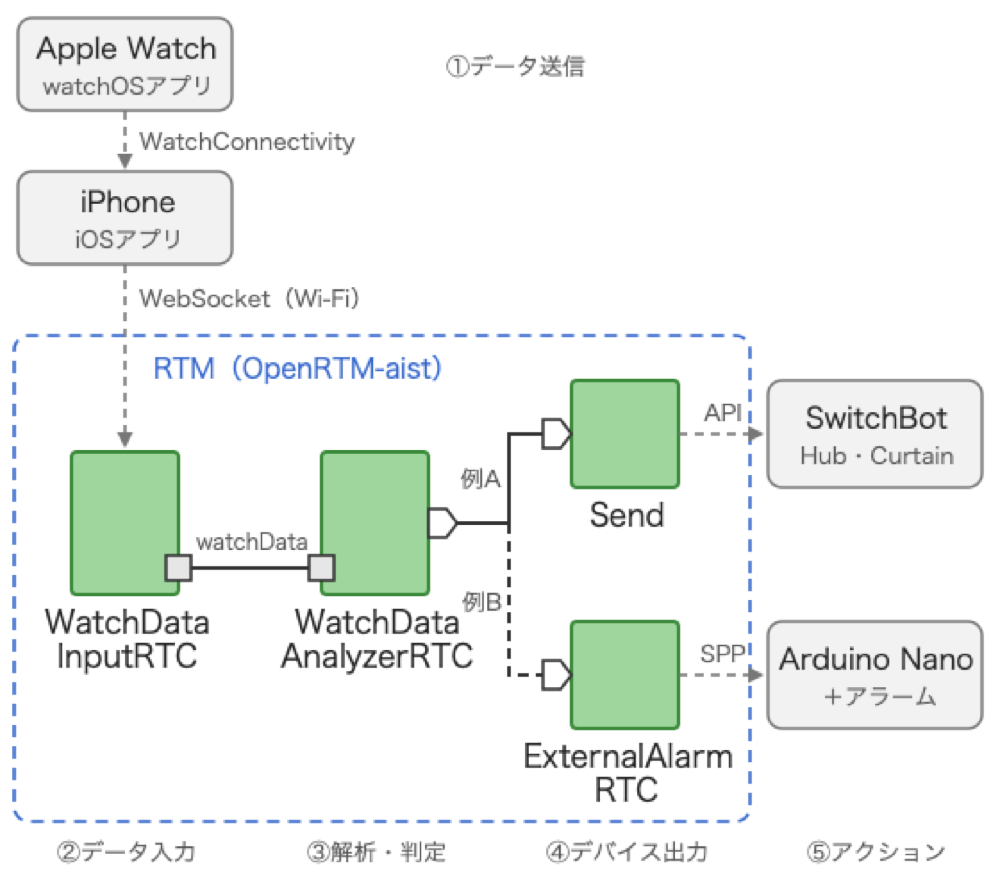

# Apple Watchのデータを利用した多目的RTCの開発

*Development of Multipurpose RT-Components Utilizing Apple Watch Data*

計測自動制御学会 SI2026 **RTミドルウェアコンテスト2026** 応募作品

**キーワード**: RTミドルウェア、アップルウォッチ、ショートカット

> 【要記入】がある箇所は、提出前に実際の値へ置き換えてください。

## 目次

1. [作品名・作品概要](#1-作品名作品概要)
2. [使用したRTミドルウェアのバージョン](#2-使用したrtミドルウェアのバージョン)
3. [開発環境・開発言語・使用デバイス](#3-開発環境開発言語使用デバイス)
4. [開発したRTCと再利用したコンポーネント](#4-開発したrtcと再利用したコンポーネント)
5. [関連ドキュメント](#5-関連ドキュメント)
6. [動作方法・デモ動画](#6-動作方法デモ動画)
7. [ライセンス・作者・謝辞](#7-ライセンス作者謝辞)

---

## 1. 作品名・作品概要

| | |
| --- | --- |
| 作品名 | **Apple Watchのデータを利用した多目的RTCの開発** |
| 種別 | RTコンポーネント（RTC）の開発（センサ入力・解析・機器出力のRTC群） |

### 概要

Apple Watchが測る加速度・方位（CoreMotion）と心拍・睡眠（HealthKit）は、純正アプリの外では使いにくく、外部機器と連携するたびに通信やデータ処理を一から作る必要があります。本作品では、これらのデータを扱う**RTコンポーネント（RTC）を開発**し、OpenRTM-aist上で他のRTCや外部機器へ提供できるようにしました。RTCのつなぎ方を変えるだけで、Apple Watchのデータを使った連携を作れます。

*We developed a set of RT-Components (RTCs) on OpenRTM-aist that make Apple Watch sensor data (acceleration, heading, heart rate, sleep) available to other RTCs and external devices such as SwitchBot and Arduino.*

### 実装した活用例

| 活用例 | 動作 |
| --- | --- |
| ジェスチャーによる家電操作 | 特定の方位を向いて腕を横に振ると、SwitchBot Curtainを全開・全閉します。腕の上下動で照明の明るさを変える機能も実装しています（既定は無効）。 |
| 心拍低下アラーム | 心拍が直近の基準から大きく下がると、Arduino Nanoにつないだブザーを鳴らします。 |

睡眠データ（HealthKit）も受信し、SQLiteに記録します。

> **注意**: 心拍低下アラームは、運転を伴わない展示・机上検証用の通知です。心拍だけで眠気や覚醒状態を判定する用途には使えません。

### 特徴

- **RTC間はデータポートでつなぎます。** 4つのRTCは`RTC::TimedString`のデータポートで接続し、RTSystemEditorからつなぎ替えることもできます。
- **安全面に配慮しています。** LAN経由の受信にはBearerトークンを必須にし、TLS（`wss://`）にも対応します。

### システム構成



*システム構成図（論文のFig.2と同じ図）*

処理の流れは次のとおりです。

1. Apple Watchのアプリが、ワークアウトセッション中にCoreMotion（50 Hz）と心拍を計測し、WatchConnectivityでiPhoneへ送ります。睡眠は、Watchの操作でHealthKitの記録をまとめて送ります。
2. iPhoneアプリが、受信したデータをWi-FiのWebSocketでPCへ送ります。心拍と睡眠は、PCからの受信確認（ACK）が返るまでiPhone内のキューに保存して再送します。加速度は、1秒より古いものを破棄します。
3. PCのホストがデータを検証してSQLiteに保存し、`WatchDataInputRTC`が最新値と新規サンプルを`watchData`ポートへ出力します。
4. `WatchDataAnalyzerRTC`が50 Hzで判定ルールを評価し、機器コマンドを出力します。
5. `Send`と`ExternalAlarmRTC`がコマンドを受け取り、SwitchBot APIまたはBluetooth SPPで機器を動かします。

**RTCとして実装している範囲**: データの取り出し、解析・判定、機器へのコマンド出力は、4つのRTCとして実装しています。RTC間のデータの受け渡し、実行周期（50 Hz）、ポート接続・活性化はOpenRTM-aistが担います。WebSocketの受信、SQLiteへの保存、SwitchBot・Arduinoとの実際の通信は、RTCの外（同じプロセス内のスレッド）で動きます。

---

## 2. 使用したRTミドルウェアのバージョン

| 項目 | 内容 |
| --- | --- |
| RTミドルウェア | **OpenRTM-aist 2.1.0-RELEASE（Python版）** |
| 使用API | `OpenRTM_aist.DataFlowComponentBase`、`InPort` / `OutPort`、`Manager`、`CORBA_RTCUtil` |
| データポート | `RTC::TimedString` |
| ポート接続 | `dataport.interface_type = corba_cdr`、`dataflow_type = push`、`subscription_type = flush`、`buffer.length = 32` |
| 実行コンテキスト | 周期実行（PERIODIC）、50 Hz |
| 補助ツール | RTSystemEditor / OpenRTP（`--manual`で手動接続・活性化。任意） |

---

## 3. 開発環境・開発言語・使用デバイス

### 開発環境

| 項目 | 内容 |
| --- | --- |
| PC | Windows 【要記入: 例 Windows 11】 |
| Python | 【要記入: 実際に使ったバージョン】（OpenRTM-aist 2.1の対応は3.10〜3.14） |
| Apple Watch / iPhoneアプリ | Xcode 【要記入】、iOS 17以降・watchOS 10以降 |
| Arduino | Arduino IDE 【要記入】（AVR core 1.8.6でATmega328P向けにコンパイル確認） |

### 開発言語

| 言語 | 用途 |
| --- | --- |
| Python | PC側のRTC、ホスト、機器出力 |
| Swift / SwiftUI | watchOSアプリ、iOSアプリ |
| C++（Arduino） | Arduino Nanoのファームウェア |

### 使用デバイス

| デバイス | 用途 |
| --- | --- |
| Apple Watch 【要記入: 機種・watchOSバージョン】 | 加速度・方位・心拍・睡眠の計測 |
| iPhone 【要記入: 機種・iOSバージョン】 | Watchからのデータ中継（WebSocket） |
| PC（Windows） | RTC群の実行 |
| SwitchBot Hub、SwitchBot Curtain / Curtain 3 | カーテンの全開・全閉 |
| SwitchBotの照明（Color Bulbなど。任意） | 照明の調光 |
| Arduino Nano（クラシック / ATmega328P） | アラームの制御 |
| Bluetooth Classic SPPモジュール（例 HC-05）、パッシブ圧電ブザー | PCとのBluetooth通信、警報音 |

### 利用したライブラリ・外部サービス

| 名称 | 用途 | 入手先 |
| --- | --- | --- |
| OpenRTM-aist 2.1 | RTミドルウェア | https://openrtm.org/ |
| websockets 15 | iPhoneからのWebSocket受信 | https://github.com/python-websockets/websockets |
| pyserial 3.5 | Bluetooth SPPのシリアル通信 | https://github.com/pyserial/pyserial |
| SwitchBot API v1.1 | カーテン・照明の操作 | https://github.com/OpenWonderLabs/SwitchBotAPI |
| Apple HealthKit / CoreMotion / WatchConnectivity | Watchのデータ取得と転送 | https://developer.apple.com/documentation/ |
| Arduino（SoftwareSerial） | ファームウェア | https://www.arduino.cc/ |

`websockets`と`pyserial`のwheelは、オフラインでインストールできるように`wheelhouse/`に同梱しています。

---

## 4. 開発したRTCと再利用したコンポーネント

### 開発したRTC（4つ）

実装は[`watchrtm/rtc.py`](watchrtm/rtc.py)です。プロファイルはvendor `WatchRTM`、category `Wearable`、version `1.0.0`、言語 Python です。

| RTC | 役割 | 入力ポート | 出力ポート |
| --- | --- | --- | --- |
| `WatchDataInputRTC` | 受信済みのデータから、型ごとの最新値と新規サンプルを取り出して出力します。 | なし | `watchData` |
| `WatchDataAnalyzerRTC` | 新規サンプルを読み、ジェスチャー・心拍のルール（[`rules.py`](watchrtm/rules.py)）が成立したときに機器コマンドを出力します。 | `watchData` | `switchbotCommand`、`alarmCommand` |
| `Send` | `curtain`と`light`のコマンドを、署名付きのSwitchBot API v1.1リクエストに変換します。 | `command` | なし |
| `ExternalAlarmRTC` | `alarm`のコマンドをBluetooth SPPでArduino Nanoへ送り、応答（`OK <id>`）を確認します。 | `command` | なし |

| 接続元（出力ポート） | 接続先（入力ポート） |
| --- | --- |
| `WatchDataInputRTC.watchData` | `WatchDataAnalyzerRTC.watchData` |
| `WatchDataAnalyzerRTC.switchbotCommand` | `Send.command` |
| `WatchDataAnalyzerRTC.alarmCommand` | `ExternalAlarmRTC.command` |

全ポートのデータ型は`RTC::TimedString`で、中身はJSONです。

| ポート | JSONの内容 |
| --- | --- |
| `watchData` | `{"v":1,"latest":{"motion":{...},"heart":{...},"sleep":{...}},"samples":[...]}`。`latest`は型ごとの最新値、`samples`はその周期に増えた新規サンプルです。 |
| 機器コマンド | `{"v":1,"id","target","action","t","sample_id"}`。`action`は`open`、`close`、`bright`、`dim`、`ring`です。 |

サンプルの項目やPC・iPhone間のプロトコルは[docs/SETUP.md](docs/SETUP.md)にまとめています。

### 他のRTCから使う

`watchData`は`TimedString`なので、他のRTCは入力ポートをつなぐだけでApple Watchのデータを使えます。`rtc.py`と同じ作法の例です。

```python
import json
import OpenRTM_aist
import RTC

class MyRTC(OpenRTM_aist.DataFlowComponentBase):
    def onInitialize(self):
        self.data = RTC.TimedString(RTC.Time(0, 0), "")
        self.port = OpenRTM_aist.InPort("watchData", self.data)
        self.addInPort("watchData", self.port)
        return RTC.RTC_OK

    def onExecute(self, ec_id):
        if self.port.isNew():
            heart = json.loads(self.port.read().data)["latest"].get("heart")
            # heart["bpm"] などを使う
        return RTC.RTC_OK
```

### 再利用したコンポーネント

| 種類 | 内容 |
| --- | --- |
| RTミドルウェア本体 | OpenRTM-aistの標準API（`DataFlowComponentBase`、データポート、実行コンテキスト、`Manager`、`CORBA_RTCUtil`）を使用し、独自の基盤は作っていません。 |
| 既存のRTC | 【要記入: 他者や先行研究のRTCを流用した場合は、流用元・変更点・ライセンスを書いてください。論文の参考文献[5]（SI2023）のSwitchBot送信コンポーネントを流用している場合はここに明記します。流用がなければ「なし（4つとも本作品で新規開発）」と書いてください。】 |
| ライブラリ | [利用したライブラリ・外部サービス](#利用したライブラリ外部サービス)を参照してください。 |

---

## 5. 関連ドキュメント

| ドキュメント | 内容 |
| --- | --- |
| 論文（SI2026予稿） | 【要記入: 論文PDFへのリンク】 |
| 概要説明スライド | 【要記入: スライドへのリンク】 |
| [docs/SETUP.md](docs/SETUP.md) | 実機のセットアップ、ジェスチャー・心拍の調整、通信プロトコルの仕様 |
| [config.example.json](config.example.json) | 実機用の設定例（判定の閾値、出力先など） |
| [SICE SI2026 併催行事](https://si2026.sice-si.org/event.php) | RTミドルウェアコンテスト2026の案内 |

ソースの構成は次のとおりです。

```text
watchrtm/     PC側ホスト（rtc.py: RTC / rules.py: 判定 / devices.py: 機器出力 / network.py: 受信）
apple/        Xcodeプロジェクト（Watch/ と iPhone/ のSwiftアプリ）
arduino/      Arduino Nanoのファームウェア
scripts/      開発用: 合成データの送信（模擬出力モードのテスト）
tests/        OpenRTM-aistを使う結合テスト
docs/         セットアップ詳細、図
wheelhouse/   オフライン用のwheel
```

---

## 6. 動作方法・デモ動画

### デモ動画

【要記入: 動画のURL】

### PC側の準備（Windows）

1. **Python**をインストールします（3.10〜3.14）。インストーラーで「Add python.exe to PATH」にチェックを入れます。
2. Pythonの後に、[OpenRTM-aist 2.1.0のWindowsインストーラー](https://openrtm.org/openrtm/en/node/7355)（`OpenRTM-aist-2.1.0-RELEASE_x86_64.msi`）をインストールします。
3. 新しいコマンドプロンプトで、次のコマンドがエラーなく通ることを確認します。

   ```bat
   python -c "import OpenRTM_aist, RTC; print(OpenRTM_aist.__file__)"
   ```

4. このリポジトリをクローンするか、ZIPをダウンロードして**すべて展開**します。以降のコマンドは、ルートフォルダー（`Start-Demo-Windows.cmd`があるフォルダー）で実行します。

### 実機で動かす

実機の手順は[docs/SETUP.md](docs/SETUP.md)に詳しく書いています。要点は次のとおりです。

1. **設定**: `config.example.json`を`config.json`にコピーします。
2. **Apple WatchとiPhone**: Macで`apple/WatchRTM.xcodeproj`を開き、`apple/Identifiers.xcconfig`の`PHONE_BUNDLE_ID`を自分のApple Developer Teamで使える値に変えて、実機にインストールします。iPhoneアプリに`ws://<PCのIP>:8765/watch`とトークンを入力して転送を開始し、Watchで計測を始めます。
3. **SwitchBot**: `SWITCHBOT_TOKEN`と`SWITCHBOT_SECRET`を環境変数に設定し、`config.json`の`output.curtain_id`にデバイスIDを書きます。
4. **Arduino Nano**: `arduino/ExternalAlarm/ExternalAlarm.ino`を書き込みます。Bluetooth SPPモジュールをPCとペアリングし、送信側のCOMポートを`config.json`の`output.serial_port`に指定します。
5. **実機への出力**: `config.json`の`output.dry_run`は`true`（開発中のテスト用の模擬出力モード）です。実機へ出力するには`false`にします。
6. **起動**: 依存ライブラリを入れてホストを起動します。LAN経由で受信するには、20文字以上のランダムな`WATCHRTM_TOKEN`が必要です（`python -c "import secrets; print(secrets.token_urlsafe(24))"`で作れます）。PCのTCP `8765`も許可してください。

   ```bat
   python -m pip install --no-index --find-links wheelhouse -r requirements.txt
   set WATCHRTM_TOKEN=（作ったトークン）
   python -m watchrtm --config config.json
   ```

### 開発用のテスト: 模擬出力モード

模擬出力モードは、**開発中のテスト用の仕様**です。実機へは出力せず、機器へのコマンドをログに記録するだけなので、Apple WatchやSwitchBotがなくても、合成データでRTC群の動作を確認できます。`config.demo.json`がこのモードの設定で、照明の調光も有効にしています。

1. 「PC側の準備」を済ませます。
2. ルートフォルダーの`Start-Demo-Windows.cmd`をダブルクリックします。初回は`wheelhouse/`から`websockets`と`pyserial`を`.deps/`へインストールします。
3. コマンドプロンプトに、機器へのコマンドが「simulated（模擬出力）」で4件記録されます（カーテン全開 → アラーム鳴動 → カーテン全閉 → 照明を明るく）。起動ログなども一緒に表示されます。ポート`8765`が空いている必要があります。

   ```text
   2026-11-25 11:26:51,242 INFO Send open simulated: Dry run
   2026-11-25 11:26:51,494 INFO ExternalAlarmRTC ring simulated: Dry run
   2026-11-25 11:26:53,294 INFO Send close simulated: Dry run
   2026-11-25 11:26:53,345 INFO Send bright simulated: Dry run
   ```

終了は、コマンドプロンプトで`Ctrl+C`を押します。ターミナルから手動で起動する場合は次のとおりです。

```bat
python -m pip install --no-index --find-links wheelhouse -r requirements.txt
python -m watchrtm --config config.demo.json
rem 別のターミナルで
python scripts\demo.py
```

### RTSystemEditorで接続する

既定では4つのRTCが自動で接続・活性化されます。RTSystemEditorから手動で接続するときは、OpenRTMのネームサーバーをPCの`127.0.0.1:2809`で起動して、次のコマンドを実行します。

```bat
python -m watchrtm --config config.json --rtm-config rtc.nameserver.conf --manual
```

RTSystemEditorで名前サーバーを追加し、上のポート表のとおりに`corba_cdr`・`push`・`flush`で接続して、`Send`・`ExternalAlarmRTC`、`WatchDataAnalyzerRTC`、`WatchDataInputRTC`の順に活性化します。

### テスト

```bat
python -m unittest discover -s tests -v
```

インストール済みのOpenRTM-aistで、WebSocket認証、データの検証と重複排除、50 Hzの実行コンテキスト、カーテン・照明・アラームのコマンドを通します。

### 動作確認の状況

| 項目 | 状況 |
| --- | --- |
| カーテンの全開・全閉（SwitchBot Curtain） | 実機で確認（論文§4.1） |
| 心拍低下アラーム（Arduino Nano、Bluetooth） | 実機で確認（論文§4.2） |
| 照明の調光 | 実装済み。論文では検証対象外（開発用の模擬出力モードで確認できます） |
| 判定の閾値、クールダウン、睡眠目標など | 論文に記載がなく、実装で選んだ初期値です（`config.example.json`） |

---

## 7. ライセンス・作者・謝辞

### ライセンス

【要記入: ライセンスを決めて、`LICENSE`ファイルを追加し、ここに名称を書いてください。】

同梱の`websockets`と`pyserial`は、それぞれのライセンスに従います。

### 作者

松村 怜、小島 晄、鈴木 翔太（芝浦工業大学附属高等学校）、山岡 佳代、米川 大地（芝浦工業大学附属中学高等学校）、日暮 大地、佐々木 毅（芝浦工業大学）

### 謝辞・参考

- OpenRTM-aist（産業技術総合研究所）
- 先行研究: 新 佳幸ほか, 「光とCO2変化に着目した脳を活性化させるためのスマートシステム」, 第24回計測自動制御学会システムインテグレーション部門講演会, pp.1405-1407, (2023)
