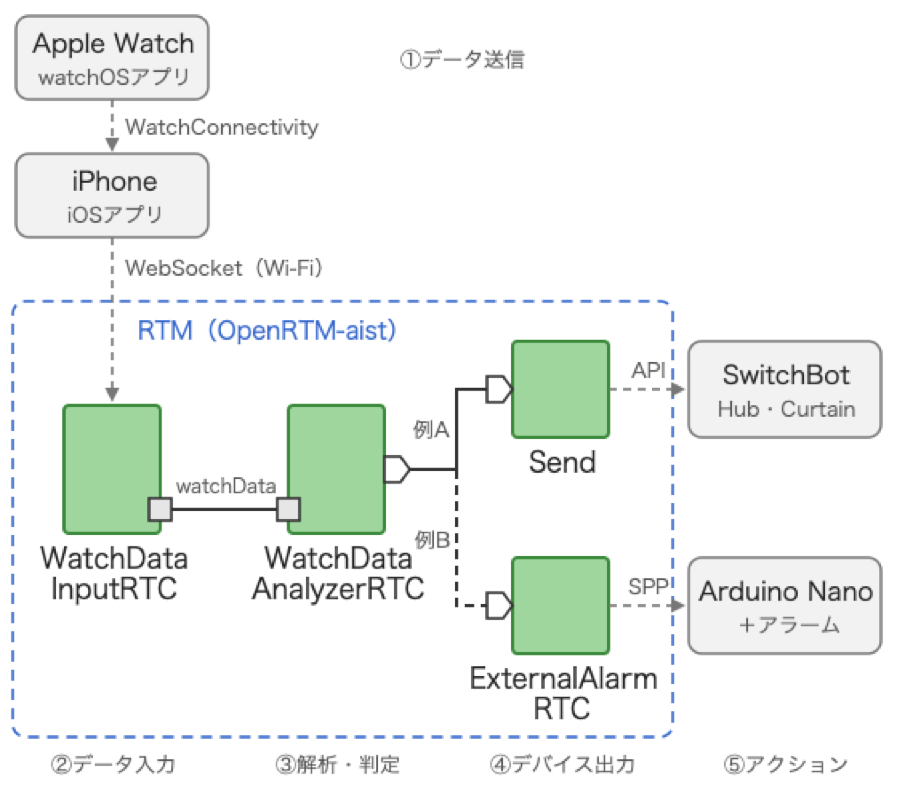

# セットアップ詳細・インターフェース仕様

> リポジトリの概要は [README](../README.md) を参照してください。コマンドは、特記がない限りリポジトリのルートフォルダー（`Start-Demo-Windows.cmd` があるフォルダー）で実行します。

論文（SI2026予稿）の§3と図2に沿って、Apple Watchの計測値をOpenRTM-aistへ取り込み、他のRTCやPCの連携アプリに提供するRTC群です。

## Windowsですぐに試す

1. リポジトリをクローンするか、ZIPをダウンロードして**すべて展開**し、ルートフォルダーを開きます。
2. `Start-Demo-Windows.cmd` をダブルクリックします。初回は同梱のライブラリを `.deps` にオフラインでインストールします。OpenRTM-aist 2.1のPython版と、インストール時に選択した `python` が必要です。
3. ブラウザーの `http://127.0.0.1:8080/` に心拍、方位、加速度、睡眠、機器コマンドが表示されます。カーテン全開・全閉、照明、心拍低下アラームが合成データで発生します。デモは模擬出力モードで、記録先は `data/demo.sqlite3` です。

同じデモを初期状態からやり直す場合はホストを停止して再起動してください。ポート `8765` と `8080` を使用します。ターミナルで起動する場合は `python -m pip install -r requirements.txt`、`python -m watchrtm --config config.demo.json` を実行し、別のターミナルで `python scripts/demo.py --open-browser` を実行します。

## 論文との対応



*システム構成図（論文のFig.2と同じ図）*

| RTC | 論文の役割 | データポート |
| --- | --- | --- |
| `WatchDataInputRTC` | WebSocketから取得したデータの最新値を保持し、型別にSQLiteへ記録 | `watchData` 出力 |
| `WatchDataAnalyzerRTC` | 50 Hzの周期実行コンテキストで新規サンプルを読み、条件成立時にコマンドを発行 | `watchData` 入力、`switchbotCommand` と `alarmCommand` 出力 |
| `Send` | SwitchBot API v1.1への署名付き命令に変換 | `command` 入力 |
| `ExternalAlarmRTC` | Bluetooth SPPでArduino Nanoに送信し、応答を確認 | `command` 入力 |

全ポートは `RTC::TimedString` です。PCのダッシュボードと同じデータはローカルの `GET /api/v1/status` から取得できます。睡眠ステージの重複区間を結合して直近24時間の睡眠を計算し、目標に届いた日は登録済みの集中作業を、届かなかった日は軽作業を先に表示します。

## 実機のセットアップ

### 1. PCホスト

デモを停止し、リポジトリのルートフォルダーでPowerShellを開きます。`config.example.json` をコピーし、まず `dry_run` を `true` のまま通信を確認します。

```powershell
python -c "import OpenRTM_aist, RTC; print(OpenRTM_aist.__file__)"
python -m pip install --no-index --find-links wheelhouse -r requirements.txt
Copy-Item config.example.json config.json
$env:WATCHRTM_TOKEN = python -c "import secrets; print(secrets.token_urlsafe(24))"
$env:WATCHRTM_TOKEN
python -m watchrtm --config config.json
```

PCとiPhoneを同じWi-Fiに接続します。PCのLAN側IPv4アドレスは `ipconfig` で確認できます。Windowsが受信許可を表示した場合は、利用するプライベートネットワークでPCのTCP `8765` を許可します。`ws://` ではデータとトークンが平文で流れるため、実データの送信には管理されたLANを使うか、信頼できる証明書を `tls_cert` と `tls_key` に設定して `wss://` を利用します。ブラウザーダッシュボードはPCのループバックに限定しています。

### 2. Apple WatchとiPhone

1. MacのXcodeで `apple/WatchRTM.xcodeproj` を開きます。対象はiOS 17以降とwatchOS 10以降です。
2. `apple/Identifiers.xcconfig` の `PHONE_BUNDLE_ID` を開発チーム固有の値に変更します。両ターゲットの **Signing & Capabilities** で同じApple Developer Teamを選び、Watch側のHealthKitを確認します。Watch側のBundle IDとiPhoneへの関連付けは `PHONE_BUNDLE_ID` から設定されます。
3. `WatchRTM iPhone` スキームでペアリング済みの実機iPhoneにビルド・実行し、Watch側にもアプリをインストールします。iPhoneアプリで `ws://<PCのIP>:8765/watch` と `WATCHRTM_TOKEN` を入力し、「転送を開始」します。iPhoneのローカルネットワークアクセスを許可します。
4. Watchで「計測を開始」を押し、HealthKitの心拍読み取りとワークアウト利用を許可します。ワークアウトセッション中にCoreMotionと心拍の取得を継続します。Watchで「睡眠ログを送信」を押すと、読み取りを許可した直近48時間のApple WatchのHealthKit睡眠レコードを送信します。睡眠記録には事前にApple Watchの睡眠計測設定が必要です。
5. PCダッシュボードで加速度と心拍の受信を確認し、時計画面を閉じた状態でも継続するか確認します。展示中はiPhoneアプリを前面に置くと再接続が安定しやすくなります。iOSのバックグラウンド実行には時間制限があり、心拍と睡眠はiPhoneの送信キューから再送し、古い加速度は破棄します。

### 3. SwitchBotとArduino Nano

- **SwitchBot Curtain / Curtain 3**。Hubのクラウド連携を有効にし、`output.curtain_id` に登録済みのデバイスIDを設定します。PowerShellの `SWITCHBOT_TOKEN` と `SWITCHBOT_SECRET` にSwitchBot APIの値を入れてホストを起動します。腕を指定方位に向け、正方向の横振りで全開、負方向で全閉です。論文で具体例として説明される上下動による照明調光は、対応するColor Bulb等の `output.light_id` と `rules.light_enabled: true` を設定します。正方向で増光、負方向で減光です。明るさは `bright_percent` と `dim_percent` で設定します。
- **Arduino Nano（クラシック / ATmega328P）**。Arduino IDEで `arduino/ExternalAlarm/ExternalAlarm.ino` を書き込みます。外付けのBluetooth Classic SPPモジュール（例 HC-05）をデータモード、UART 9600 baudで使用します。モジュールTX→Nano D2、Nano D3→モジュールRX、GND共通です。モジュールRXが3.3 V系ならD3の5 V信号を適切にレベル変換し、モジュール電源は使用する基板仕様に合わせます。D9には適切な定格のパッシブ圧電ブザーを接続します。電流の大きいブザーはトランジスター等のドライバーを介します。PCでペアリングし、**送信側SPP COMポート**を `output.serial_port`（例 `COM7`）に指定します。USB書き込み用のCOMポートとは別です。
- 実機出力は `output.dry_run` を `false` にしてホストを再起動すると有効になります。SwitchBotのAPI受理とカーテン動作の完了は別なので、最後まで動くことを目視確認します。アラームは、運転を伴わない展示・机上検証用の心拍低下通知です。心拍だけで眠気や覚醒状態を判定する用途に使えません。

### 4. ジェスチャーと心拍を調整する

静止時の腕の方位をダッシュボードで読み、`heading_deg` と `heading_tolerance_deg` を調整します。磁北基準が利用できないWatchではセッション開始時が方位の基準です。装着側とWatch本体の向きによって横方向の符号が変わるため、模擬出力モードで開閉を確認します。加速度は重力成分を除いた `g` 単位で、カーテンはWatchのX軸を水平面に投影した成分、照明は上下成分を使います。一度静止域に戻してから次のコマンドを受け付けます。

心拍低下通知は直近の閾値超えサンプルの中央値（最低3件）からの低下量と絶対閾値を併用します。既定は `55 bpm` 以下かつ `12 bpm` 以上の低下が新しい計測値で2回連続した場合です。加速度・心拍の判定閾値、クールダウン、睡眠目標、照明機種、SPPモジュール、配線ピン、アラーム鳴動時間は論文に記載がなく、この実装で選んだ初期設定です。

## OpenRTP / RTSystemEditorと接続仕様

既定起動では4 RTCを自動生成・接続・活性化します。GUIで接続する場合はOpenRTMのネームサーバーを同じPCの `127.0.0.1:2809` で起動し、`python -m watchrtm --config config.json --rtm-config rtc.nameserver.conf --manual` を実行します。RTSystemEditorで名前サーバーを追加し、表のポートを `corba_cdr`・`push`・`flush` でつなぎ、出力RTC、解析RTC、入力RTCの順に活性化します。自動接続時も `--rtm-config rtc.nameserver.conf` を指定すると、同じPCのRTSystemEditorから構成を確認できます。

| インターフェース | ペイロード |
| --- | --- |
| iPhone → `WS /watch` | テキストJSON `{"v":1,"id":"<batch UUID>","samples":[...]}`。LANでは `Authorization: Bearer <token>`。1～96件。SQLiteコミット後 `{"v":1,"ack":"<batch UUID>","stored":件数}` を返信 |
| 共通サンプル | `id` UUID、`kind`、`t` Unix時刻（秒）。`motion` は `ax`、`ay`、`az`、`lateral`、`vertical`（g）、`yaw`（°）、`frame`（`magnetic` / `relative`）。`heart` は `bpm`。`sleep` は `start`（秒）、`stage`（HealthKit値）、`t`（終了時刻） |
| `watchData` | `{"v":1,"latest":{"motion":{...},"heart":{...},"sleep":{...}},"samples":[...]}`。`latest` は型ごとの最新値、`samples` は当該周期の新規受信分 |
| RTCの機器コマンド | `v`、`id`、`target`、`action`、`t`、`sample_id` を含むJSON。アクションは `open`、`close`、`bright`、`dim`、`ring` |
| PC → SPP | `ALARM <uuid>\n` を送信し `OK <uuid>\r\n` を待機 |

## 検証

`python -m unittest discover -s tests -v` は、インストール済みのOpenRTM-aistを使用する結合テストです。WebSocket認証、データ検証と重複排除、50 Hzの実行コンテキスト、カーテンの全開・全閉、照明調光、アラームの模擬出力、睡眠集計、PC連携APIを通します。配布版でのホスト起動とデモデータの送信、Arduino AVR core 1.8.6を使ったATmega328P向けファームウェアのコンパイル・リンクを確認済みです。MacでのXcodeビルド・署名、ペアリング済みApple WatchとiPhoneの実機通信、SwitchBotとBluetooth SPP機器の物理動作は別途確認が必要です。

## 公式資料

- [OpenRTM-aist 2.1のインストール](https://openrtm.org/openrtm/en/book/export/html/7345)
- [Apple Watchのワークアウトアプリ](https://developer.apple.com/documentation/healthkit/build-a-workout-app-for-apple-watch)
- [Watch Connectivityでの転送](https://developer.apple.com/documentation/watchconnectivity/transferring-data-with-watch-connectivity)
- [SwitchBot API v1.1](https://github.com/OpenWonderLabs/SwitchBotAPI)
- [Arduino Nano](https://docs.arduino.cc/hardware/nano/)
